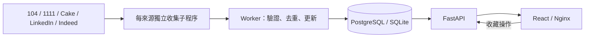

# Architecture：AI Agent 快速導覽

## 服務與邊界

- `frontend/`：React、TypeScript、Vite；Nginx 提供 build 並代理 `/api/` 到 API。
- `backend/app/main.py`：REST API，只讀 DB 與操作收藏，不 import 任何收集連接器。
- `backend/app/locations.py`：中文／英文地區別名，讓多地區職缺可按各地區搜尋，避免 New Taipei 誤判為 Taipei。
- `backend/app/worker.py`：APScheduler、啟動收集、執行租約、子程序管理與來源狀態。
- `backend/app/ingestion/`：各來源連接器、薪資清理、JSON-lines 子程序協議與 upsert。
- `backend/migrations/`：Alembic。Compose migrate 成功後才啟動 API／Worker。

## 資料模型

| 表 | 關鍵資訊 |
|---|---|
| jobs | `(source, external_id)` 唯一鍵；原始薪資、年化欄位、技能、來源網址、内容 hash、首次／最後看見時間 |
| bookmarks | job_id 為主鍵與 FK；本機單一使用者收藏 |
| source_states | 每來源最新狀態、進度、最後完整成功時間、部分失敗與截斷提示 |
| collection_runs | 執行觸發原因、時間、成功／部分失敗／中斷結果 |
| worker_locks | 帶 owner 與期限的 DB 租約，阻止同時收集 |

SQLite 啟用 WAL 與 foreign keys；PostgreSQL 使用 psycopg。真正欄位定義以模型及 migration 為準。

Migration 0002 新增 jobs.detail_status／detail_collected_at，以及 source_states.reason_code／next_retry_at／last_data_at。舊 LinkedIn 描述為空者標 pending；已有描述者以最後看見時間初始化詳情時間，保留原職缺與收藏。

## Worker 生命週期

1. 啟動每日排程；若 `COLLECT_ON_STARTUP=true`，立即收集。
2. 原子取得租約，執行中每租約期限的 1/3 續租。
3. 最多同時兩個來源子程序；每來源依序處理關鍵字及分頁。
4. 子程序輸出 `job`、`detail`、`progress`、`lists_finished`、`finished` JSON 行，stderr 為診斷。LinkedIn 的 lists_finished 由父程序在列表 commit 完成後透過 stdin 回覆 lists_saved，才允許查詢 DB 詳情候選；避免輸出與 DB 寫入競速。
5. 父程序重新驗證來源與網址，每筆 commit，保存部分成果。
6. 超時或取消時結束子程序並保存狀態；結束釋放租約。
7. 每次重啟重新收集最新資料，漏掉的每日排程不重播。

狀態為 idle／running／success／partial／error／interrupted，disabled 由當前設定決定。僅全關鍵字成功才更新 last_success_at；API 看到 running 但沒有有效租約時顯示 interrupted。

取得租約後，每來源先檢查 next_retry_at；仍在冷卻時不啟動子程序、不建立新的 collection_run。429 不重試，冷卻至少一小時並尊重 Retry-After（秒數／HTTP 日期）；403／452／驗證與載入受阻預設一天。原狀態、部分資料、最後取得資料時間保留。到期後依原每日排程或下次啟動嘗試。

Settings.for_source 套用 SOURCE_REQUEST_DELAYS／SOURCE_REQUEST_TIMEOUTS／SOURCE_TIMEOUTS JSON 物件；LinkedIn 預設 10 秒及 3600 秒，其他來源使用全域值。JobSpy 兩種 HTTP Session 均套用間隔與逾時，隔離子程序中暫時包裝 request 並在 finally 還原。

LinkedIn 列表先完成所有關鍵字，然後由 linkedin_details 選本輪看見的職缺：未取得優先、成功取得七天內跳過、每輪最多 20 筆。詳情失敗停止該階段，來源標 partial，列表仍已寫入。listing／details 缺少描述、技能或薪資不清空既有值；詳情刷新不更新列表 last_seen_at。API 提供 detail_status，前端 pending 顯示「詳情尚未取得」。

## 搜尋與薪資

- 搜尋只讀資料庫，依關鍵字、來源、地區與薪資組合條件，預設每頁 20 筆。
- content_hash 改變才更新 updated_at；重複看見只更新 last_seen_at。
- 月薪 × 12、年薪直接比較，只接受 TWD；未知、外幣及時薪預設納入結果。
- 沒找到、來源失敗、分頁截斷均不自動下架既有職缺。
- 前端 debounce 300ms、AbortController 與查詢代次避免舊結果覆蓋。
- 前端每 5 秒讀來源狀態，收集結果更新時重新查詢資料庫。

## 接口

`/api/v1/jobs`、`/jobs/{id}`、`/sources`、`/bookmarks`、`/bookmarks/{id}`、`/health`；詳見 FastAPI `/docs`。

`GET /jobs` 接受 q、city、重複 sources、min_annual_salary、include_unknown_salary、page、page_size。回傳 items、total、page、page_size。金额單位新台幣元。

GET /sources 新增 reason_code、next_retry_at、last_data_at，分別顯示來源限流／驗證／載入受阻原因、下次可嘗試時間及最後取得資料時間。GET /jobs 與單筆／收藏新增 detail_status、detail_collected_at。API 的新增欄位僅讀 DB。

## 部署與配置

Compose：db → migrate → api／worker → frontend。PostgreSQL 具名 volume 持久化；僅 frontend 及 API 的連接埠映射到 127.0.0.1，DB 不對外映射。

根目錄 `.env`，Pydantic Settings 讀取；Compose 覆蓋內部 DATABASE_URL。`.env` 不進 build context 或 Git。原生開發 SQLite 與 Compose PostgreSQL 資料分離。

Node 與 Python Playwright 的瀏覽器版本各自安裝；容器中的 Chromium 只屬於 Worker。API 不安裝瀏覽器。

## 目前驗收界線

Cake、LinkedIn、Indeed 已取得真實職缺；104 仍為 403／驗證頁，1111 正常等待後仍為空白 Loading 頁。LinkedIn 分離詳情後，小批量成功，但完整範圍列表仍 429。這三站完整接入仍未驗收完成。連接器實作與離線解析測試不代表來源可存取。
來源狀態以 DB 為準；完整成功時間與部分成功分開。Cake 使用 pageMap 及 total_pages，即使一頁只有其他來源轉載，也繼續處理後續頁面。

104 先 HTTP 頁面暖身與內部 JSON，失敗後本輪切換至一般 BrowserSearch，擷取頁面實際搜尋 JSON 或解析 DOM；正常成功時重用同一瀏覽器處理分頁。1111 使用同一 BrowserSearch 解析 JSON-LD／卡片。遇人工驗證即停止，不登入、不保存瀏覽器 profile。明確零結果提示才能當空結果成功；隱藏的驗證／零結果提示不能作為可見狀態的證據。104 網址 slug 與 JSON jobNo 透過限定的網址比對保持既有身份。

測試使用 `test_*` DB 或獨立暫存 SQLite，透過 Session factory／dependency override 隔離。`test_postgres.py` 讓預設 DB 指向空白記憶體，防止誤用正式連線。

## 接手檢查

讀 AGENTS → Git status → modify／lesson → 模型与 migration → pytest → frontend build → Compose／瀏覽器。五站接入是否完成以真實來源實測為準，不能以有連接器檔案或測試 fixture 通過代替。
