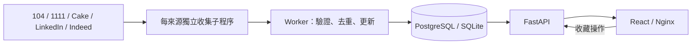

# Architecture：AI Agent 快速導覽

## 服務與邊界

- `frontend/`：React、TypeScript、Vite；Nginx 提供 build 並代理 `/api/` 到 API。
- `backend/app/main.py`：REST API，只讀 DB 與操作收藏，不 import 任何收集連接器。
- `backend/app/worker.py`：APScheduler、啟動收集、執行租約、子程序管理與來源狀態。
- `backend/app/ingestion/`：各來源連接器、薪資清理、JSON-lines 子程序協議與 upsert。
- `backend/migrations/`：Alembic。Compose migrate 成功後才啟動 API／Worker。

## 資料模型

| 表 | 關鍵資訊 |
|---|---|
| jobs | `(source, external_id)` 唯一鍵；原始薪資、年化欄位、技能、來源網址、内容 hash、首次／最後看見時間 |
| bookmarks | job_id 為主鍵與 FK；本機單一使用者收藏 |
| source_states | 每來源最新狀態、進度、最後完整成功時間、部分失敗與截斷提示 |
| collection_runs | 執行觸發原因、時間、成功／部分失敗／中斷結果 |
| worker_locks | 帶 owner 與期限的 DB 租約，阻止同時收集 |

SQLite 啟用 WAL 與 foreign keys；PostgreSQL 使用 psycopg。真正欄位定義以模型及 migration 為準。

## Worker 生命週期

1. 啟動每日排程；若 `COLLECT_ON_STARTUP=true`，立即收集。
2. 原子取得租約，執行中每租約期限的 1/3 續租。
3. 最多同時兩個來源子程序；每來源依序處理關鍵字及分頁。
4. 子程序輸出 `job`、`progress`、`finished` JSON 行，stderr 為診斷。
5. 父程序重新驗證來源與網址，每筆 commit，保存部分成果。
6. 超時或取消時結束子程序並保存狀態；結束釋放租約。
7. 每次重啟重新收集最新資料，漏掉的每日排程不重播。

狀態為 idle／running／success／partial／error／interrupted，disabled 由當前設定決定。僅全關鍵字成功才更新 last_success_at；API 看到 running 但沒有有效租約時顯示 interrupted。

## 搜尋與薪資

- 搜尋只讀資料庫，依關鍵字、來源、地區與薪資組合條件，預設每頁 20 筆。
- content_hash 改變才更新 updated_at；重複看見只更新 last_seen_at。
- 月薪 × 12、年薪直接比較，只接受 TWD；未知、外幣及時薪預設納入結果。
- 沒找到、來源失敗、分頁截斷均不自動下架既有職缺。
- 前端 debounce 300ms、AbortController 與查詢代次避免舊結果覆蓋。
- 前端每 5 秒讀來源狀態，收集結果更新時重新查詢資料庫。

## 接口

`/api/v1/jobs`、`/jobs/{id}`、`/sources`、`/bookmarks`、`/bookmarks/{id}`、`/health`；詳見 FastAPI `/docs`。

`GET /jobs` 接受 q、city、重複 sources、min_annual_salary、include_unknown_salary、page、page_size。回傳 items、total、page、page_size。金额單位新台幣元。

## 部署與配置

Compose：db → migrate → api／worker → frontend。PostgreSQL 具名 volume 持久化；僅 frontend 及 API 的連接埠映射到 127.0.0.1，DB 不對外映射。

根目錄 `.env`，Pydantic Settings 讀取；Compose 覆蓋內部 DATABASE_URL。`.env` 不進 build context 或 Git。原生開發 SQLite 與 Compose PostgreSQL 資料分離。

## 接手檢查

讀 AGENTS → Git status → modify／lesson → 模型与 migration → pytest → frontend build → Compose／瀏覽器。五站接入是否完成以真實來源實測為準，不能以有連接器檔案或測試 fixture 通過代替。
